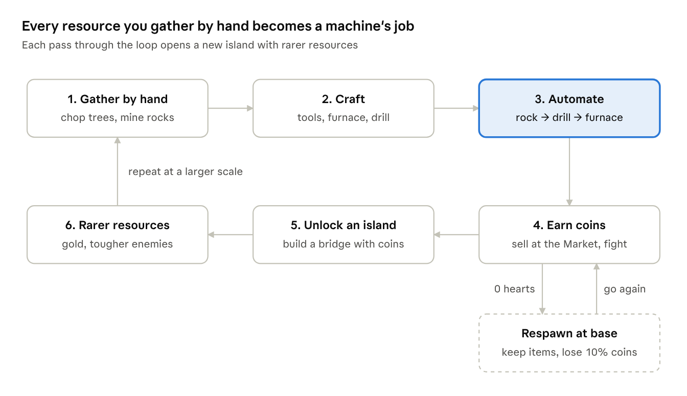

# Driftlands: Game Design Document

## Overview

Driftlands is a single-player, top-down 2D game about gathering, crafting and automation, made in Godot 4.7. You start with nothing on a small island, gather by hand, build machines that take over that work, then unlock new islands and beat the boss.

- **Pitch:** every resource you collect by hand today becomes a machine doing it for you tomorrow.
- **Inspiration:** Forager's gather, craft and unlock-islands loop. Factorio-style automation, but casual.
- **Team:** Gert M. Eljas (producer), Tanel Metshein (programmer), Andre Olonen (game designer), Argo Luur (artist).
- **How to read this doc:** **Built** means it works in the prototype on `main` today. **Planned** means it is the design for the MVP and is not in the game yet.

## Rules & mechanics

The player moves on one grid of islands and does everything with one button: left click swings, opens or places, depending on what is held and what is under the cursor.

1. **Movement (Built).** W A S D, 70 px/s. Water blocks you. You stand still while a menu is open.
2. **Gathering (Built).** Left click swings toward the cursor in 4 directions. The target gets a white outline. Trees, rocks and enemies take 3 hits by hand, 2 with the matching stone tool. Iron rocks take 4 hits.
   - A tree gives 3 wood. A rock gives 3 stone. An iron rock gives 2 iron ore.
   - **Tools:** the axe is strong against trees, the pickaxe against rocks and the sword against enemies. Anything else does 1 damage.
3. **Regrowth (Built).** Every 6 s a tree, rock or iron rock grows on a free cell, up to 14 per island. You can't run out.
4. **Inventory (Built).** 32 slots: 8 hotbar + 24 bag. Same items stack.
   - Drag to move, swap or merge. Shift+click sends a stack across. Right click splits it.
   - **Sort** orders the bag only, so your hotbar layout stays.
   - New tools and buildings go to the hotbar, resources to the bag.
5. **Crafting (Built).** Q opens a separate crafting screen with categories (Tools, Weapons, Buildings, Machines, Resources, Food), a search box and favorites. Pick a recipe to see what it needs; missing items show in red.
   - Ingredients are taken when you queue. Each item takes its craft time.
   - Cancelling a job gives the ingredients back.
6. **Buildings (Built).** Select a building in the hotbar and click a cell to place it. A green ghost means it can go there, red means it is blocked or too far.
   - Click a placed machine to open its screen. **Pick up** returns it with its contents.
7. **Furnace (Built).** Burns wood (8 s per piece) only while smelting. 2 iron ore make 1 iron ingot in 4 s. The screen says why it is idle.
8. **Automation (Built).** A drill next to a rock or iron rock mines 1 piece every 6 s, forever, without using the rock up. It pushes the piece into a machine next to it, otherwise keeps it in its own slot.
   - **The chain:** iron rock → drill → furnace → ingots. You only bring wood and collect ingots.
9. **Health and combat (Planned).** 5 hearts. An enemy touching you takes 1 heart. Food restores 1 heart.
10. **Respawn (Planned).** At 0 hearts you respawn at your base on the starting island with full hearts and keep your inventory. Penalty: you lose 10% of your coins.
11. **Islands (Planned).** You reach new islands by building a bridge to them. Each bridge costs coins.
12. **Coins (Planned).** Enemies drop coins. A Market building sells items for coins.
13. **Droids (Planned).** A droid gathers on its island by itself and brings the items to you.
    - **No screen clutter:** a Droids menu hides, shrinks or recalls them all.

## Goals and end states

You win the prototype by defeating the boss on the third island. You cannot lose for good: dying only sends you back to your base.

- **Long-term goal:** grow from a stranded survivor into a builder whose islands run on machines and droids.
- **Short-term goals** lead you there:
  - Craft your first tools.
  - Get the drill → furnace chain running.
  - Earn coins for the bridges.
  - Build an iron sword strong enough for the boss.
- **Win (Planned):** defeat the Stone Golem. A "You beat Driftlands" screen shows your play time. You can keep playing afterwards.
- **Lose (Planned):** there is no game over. At 0 hearts you respawn at your base on the starting island with full hearts. You keep your inventory, your machines and your islands, and lose 10% of your coins. Death costs a walk back and a few coins, never your progress (the one-pager's fair respawning).

## Game resources and objects/items

The prototype has 6 resources and 11 craftable items. 6 of the craftables are built. Numbers for planned items are first proposals for Andre to balance.

**Resources**

| Resource | Where it comes from | Used for | Status |
| --- | --- | --- | --- |
| Wood | Trees, 3 per tree | Tools, furnace fuel (8 s each) | Built |
| Stone | Rocks, 3 per rock | Tools, furnace, drill | Built |
| Iron ore | Iron rocks, 2 per rock; a drill | Smelted into iron ingots | Built |
| Gold ore | Gold rocks on island 2 | Smelted into gold ingots | Planned |
| Berries | Berry bushes on the starting island | Food: restores 1 heart | Planned |
| Coins | Enemies; selling at the Market | Bridges to new islands | Planned |

**Craftable items**

| Item | Recipe | Made in | What it does | Status |
| --- | --- | --- | --- | --- |
| Stone axe | 3 wood + 2 stone | Hand | Chops trees in 2 hits | Built |
| Stone pickaxe | 3 wood + 3 stone | Hand | Mines rocks in 2 hits | Built |
| Stone sword | 2 wood + 3 stone | Hand | Kills skeletons in 2 hits | Built |
| Furnace | 8 stone + 2 wood, 5 s | Hand | Smelts ore into ingots, burns wood | Built |
| Iron ingot | 2 iron ore, 4 s | Furnace | Drill and iron gear | Built |
| Drill | 3 iron ingots + 6 stone, 6 s | Hand | Mines a rock next to it forever and feeds a machine next to it | Built |
| Gold ingot | 2 gold ore, 5 s | Furnace | Droid; sells for the most coins | Planned |
| Iron pickaxe | 3 iron ingots + 2 wood | Hand | Mines rocks and gold rocks faster | Planned |
| Iron sword | 3 iron ingots + 2 wood | Hand | Needed to beat the boss | Planned |
| Market | 10 wood + 10 stone | Hand | Sells items for coins | Planned |
| Droid | 2 iron ingots + 1 gold ingot | Hand | Gathers on its own | Planned |

**World objects:** trees, rocks, iron rocks and gold rocks can be harvested and grow back. A drill turns any rock next to it into an endless deposit.

## NPCs and enemies

The prototype has one helper (the droid), one enemy (the skeleton) and one boss (the Stone Golem). Only the skeleton exists today, as a training dummy that doesn't move.

| Character | Where | Behaviour | Health and damage | Drops | Status |
| --- | --- | --- | --- | --- | --- |
| Droid (helper) | Follows you; works on the island where you place it | Walks to the nearest tree or rock, gathers it, carries up to 10 items back to you, repeats. Hidden, shrunk or recalled from the Droids menu | Can't be hurt | — | Planned |
| Skeleton (enemy) | Island 2, around the gold rocks | Wanders. Within 5 cells it chases you; touching you costs 1 heart, then it backs off 1 s | 3 hits by hand, 2 with a stone sword | 2–4 coins | Built as a dummy; AI planned |
| Stone Golem (boss) | Island 3, alone in an arena | Slams the ground (a telegraphed circle, 2 hearts); throws rocks at you; at half health calls 2 skeletons | 30 health; only the iron sword (3 per hit) hurts it | Golem core (the win) and 50 coins | Planned |

- **Balanced combat curve:** skeletons on later islands get more health instead of new enemies being added. The Golem is tuned for a player with an iron sword and about 10 berries.
- **Optional NPCs** with quests and lore are in the one-pager but out of scope for the prototype.

## Unlockable abilities

In the prototype you unlock abilities through items, not skill points. Each new material opens the next tool, machine or island. The XP and skill trees from the one-pager come after the prototype.

| Ability | How you unlock it | What it lets you do | Status |
| --- | --- | --- | --- |
| Faster gathering | Craft a stone axe or pickaxe | Trees and rocks in 2 hits instead of 3 | Built |
| Building | Craft a furnace | Place buildings and smelt ore into ingots | Built |
| Automation | 3 iron ingots for a drill | Endless ore with no clicking | Built |
| Selling | Build a Market | Turn spare items into coins | Planned |
| New island | Coins for a bridge | Reach island 2 (gold, skeletons), then island 3 (the boss) | Planned |
| Helpers | A gold ingot for a droid | Gathering happens without you | Planned |
| Boss fight | Craft an iron sword | Damage the Stone Golem | Planned |
| Skill trees | XP from gathering and combat | Boost gathering, combat or automation | After the prototype |

## Core loop

Steps 1 to 6 repeat on every island, each time with rarer resources and more machines. Dying never breaks the loop: you respawn at your base and go again.

## Progression

Progression runs through 5 stages over 3 islands. Each stage adds one new mechanic, and one item or goal opens the next stage.

| Stage | Island | What's new | New items | Challenge | Unlocks the next stage |
| --- | --- | --- | --- | --- | --- |
| 1. Stranded | 1: Starting island | Gathering by hand, inventory, crafting | Stone axe, pickaxe, sword | Everything is slow by hand | 8 stone + 2 wood for a furnace |
| 2. Smelting | 1 | Placing buildings, fuel, smelting | Furnace, iron ingot | Keeping the furnace fed with ore and wood | 3 iron ingots for a drill |
| 3. Automation | 1 | Machines feeding machines | Drill, Market, coins | Laying out rock → drill → furnace; earning coins | Coins for the bridge to island 2 |
| 4. Expansion | 2: Gold island | Combat, health, respawn, a second resource | Gold ore, gold ingot, droid, iron pickaxe | Skeletons chase you; dying sends you home | Iron sword + coins for the bridge to island 3 |
| 5. The boss | 3: Golem island | Boss fight | Iron sword, berries for healing | Stone Golem: telegraphed slams, thrown rocks, summoned skeletons | Defeat it to win |

The resource you gather by hand in one stage is automated in the next. Iron ore is mined by hand in stage 2 and by drills from stage 3. Gold is mined by hand on island 2 until the droid takes over.

## Prototype status

3 of the 7 MVP goals are done: the inventory, crafting and the automation chain are on `main`, merged through 3 pull requests and covered by 121 automated checks.

| MVP goal (one-pager) | Status |
| --- | --- |
| Basic inventory with sorting and stacking | Done |
| 5–6 resources and about 10 craftables | 3 resources and 6 craftables done |
| One working automation chain (drill → furnace → ingots) | Done |
| 2–3 islands | 1 island |
| One droid with "no screen clutter" | Not started |
| 1 basic enemy and 1 boss | Skeleton dummy only |
| Respawn at base on death | Not started |

**Next implementation steps,** in order, each one pull request:

- [ ] Health, the skeleton chasing and hitting you, respawn at base
- [ ] Coins, the Market and berries
- [ ] Island 2 with gold rocks, the bridge, gold ingot and iron gear
- [ ] The droid and the Droids menu
- [ ] Island 3 and the Stone Golem, and the win screen
